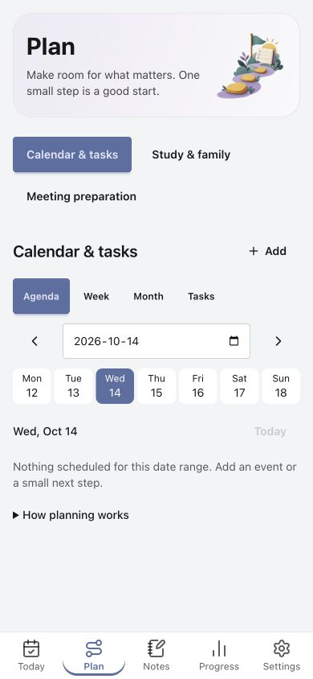
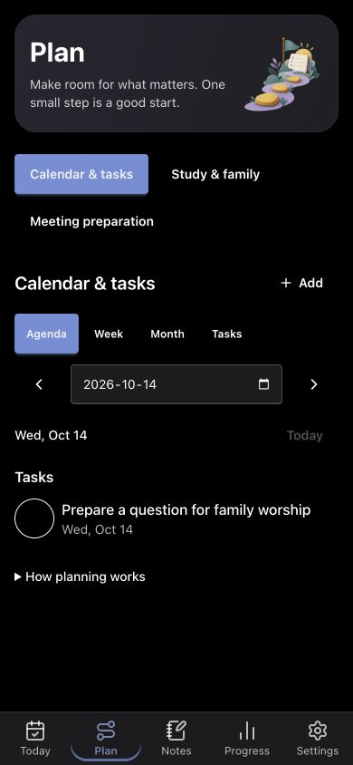
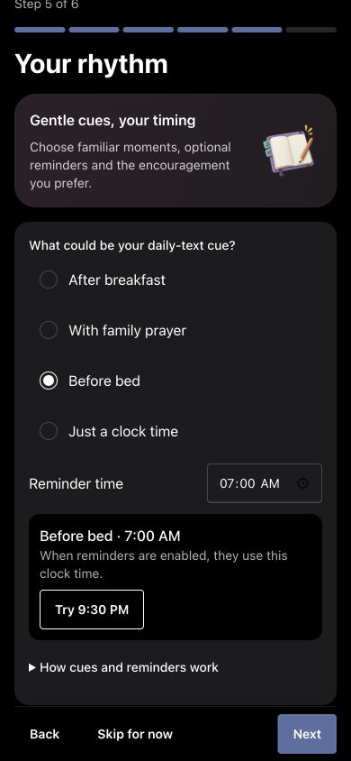
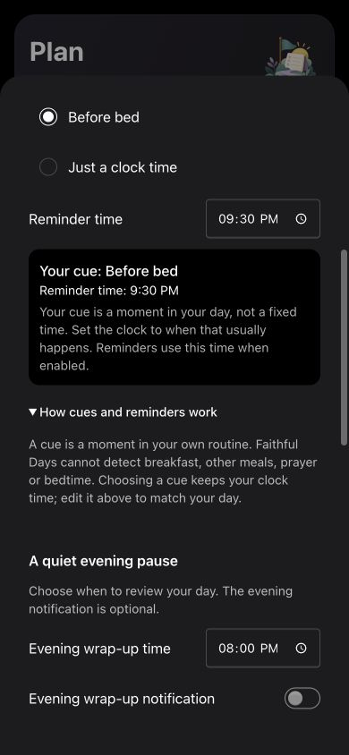

# UI review: 14 October 2026

Synthetic, isolated browser data only. Baseline frames 05/11 use48d86fd;
32/34 use0d09481; 36/40 use d23d223. The review started at82/100 and
rated the first local polish86/100. Later simplification is not rescored.
No score certifies native release readiness.

## Acceptance evidence

- Daily agenda removes the redundant date strip; Week and Month retain grids.
- Choosing a Week date returns to Agenda on that date.
- Reminder cue and clock stay independent, labelled separately.
- Theme setup explains preview versus application on finishing setup.
- Note previews avoid duplicated generated titles; stored body remains intact.
- Preparation has one entry in organiser mode.
- Dark native date controls use the active scheme.
- Update banners reserve space above the heading, removed on dismissal.

1,030 tests, lint, format and production build passed. Changed journeys were
manually reviewed in the rendered production build.320px had no document
overflow; earlier captures cover390px,768px and844px landscape. All35 original
frames plus follow-up captures remain in the local audit report. This scoped
change does not claim a new complete system-state matrix:200% zoom, full
light/dark/error/offline/recovery coverage, manual assistive technology and
native/device acceptance remain outstanding in196/176/192/197. Previous CI
browser checks are separate from these fresh manual captures.

## Before and after

### Planning baseline

### Simplified daily agenda

### Timing baseline

### Cue and clock guidance

### Update clearance

### Note preview

